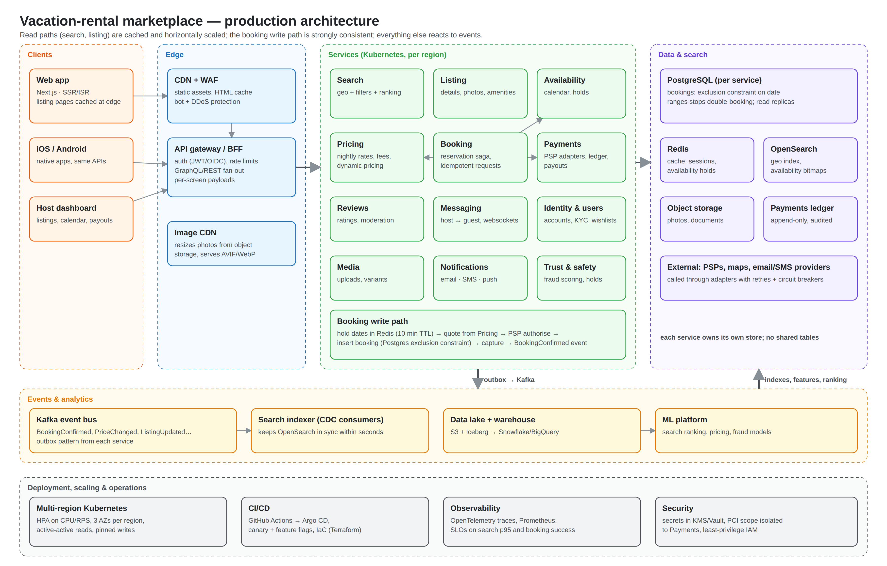

# Airbnb listing clone

A rebuild of the reference listing page (https://airbnb-clone-umber-two.vercel.app) with its
Photo tour and Lightbox, written from scratch in Next.js 16 + TypeScript + CSS Modules. Every
size, colour, spacing and timing was measured off the rendered reference, then checked with
pixel diffs. None of the reference's JS or CSS was read or copied. Only its photos, the Cereal
font and the icon artwork are reused as assets.



## Run it

Node 20.9+.

```bash
npm install
npm run dev          # http://localhost:3000
npm run build && npm start   # production build
```

| Check                          | Command                                                 |
| ------------------------------ | ------------------------------------------------------- |
| Types, lint, formatting        | `npm run check`                                         |
| Behaviour + axe accessibility  | `npm run build && npm run test:e2e`                     |
| Screenshots of the clone       | `npm run parity:capture -- --url http://localhost:3000` |
| Pixel diff vs the reference    | `npm run parity:diff`                                   |
| Rebuild the architecture files | `node docs/architecture/diagram.mjs`                    |

The e2e suite uses Playwright's Chromium. Run `npx playwright install chromium` once, or point
`PW_CHROMIUM_PATH` at an existing Chrome.

## What's in it

- **Listing page:** header, title with Share/Save, hero grid, overview, description, sleeping
  spaces, amenities (with the full list in a dialog), availability calendar, sticky booking card,
  reviews, map, host, things to know and nearby stays. A section bar slides in after the photos
  and highlights the section you're in.
- **Photo tour:** opens from "Show all photos" or any hero photo and scrolls to that photo. Room
  chips jump to each room, and the photos are laid out in the same full/pair rhythm as the
  reference.
- **Lightbox:** opens from any tour photo. It has previous/next buttons and ←/→ keys, both
  disabled at the ends, a live "n of 43" counter, and Escape takes you back to the tour.
- **Shared URLs:** gallery state lives in the URL, using the reference's own parameters
  (`?modal=PHOTO_TOUR_SCROLLABLE&modalItem=1004`). Back/forward close overlays one at a time.

## How the code is laid out

```
src/app                 route, root layout, design tokens, self-hosted font
src/data/listing.ts     all listing content, typed (src/types/listing.ts)
src/components/
  header/               site header, section bar
  listing/              title, photo grid, overview, description, sleeping, amenities, things to know
  booking/              booking state, calendar, booking card
  reviews/ location/ host/ nearby/
  gallery/              URL-synced gallery state, Photo tour, Lightbox
  ui/                   Dialog, Toast, Avatar, icons
src/hooks, src/lib      scroll lock, presence (exit transitions), wishlist, dates, formatting
tests/e2e               Playwright behaviour tests and axe scans
scripts/parity          capture + pixel diff tooling
parity/reference        reference screenshots the diff compares against
docs/architecture       production architecture (.excalidraw source, SVG, PNG, PDF)
```

A few decisions worth knowing:

- **Server components by default.** Only the parts with state (gallery, booking, toasts, the
  section bar, the carousel) are client components. The page ships as static HTML.
- **No state library.** Three small contexts cover everything: gallery, booking and toasts.
  The gallery reads the URL through `useSyncExternalStore`, so the address bar is the only
  source of truth and deep links need no extra code.
- **Dialogs stack.** The lightbox opens over the tour, and a shared link can open both at once.
  `Dialog` keeps a single stack that decides what is inert, so opening or closing one never
  breaks the other.
- **Exit animations without a library.** Entry uses `@starting-style`. Exit uses a small
  `usePresence` hook that keeps the overlay mounted until its fade-out finishes.

## Fidelity

`npm run parity:diff` compares the clone with reference screenshots at 13 scroll positions, plus
the tour and the lightbox, all in the same 1366×543 window. The latest run shows 0.2–4.6% of
pixels differing (tour 9%). What's left is photo resampling, Windows-vs-Linux text smoothing and
emoji glyphs, and headless Chromium's scrollbar not taking up width. The sub-agent review
measured every remaining cluster and found no geometry or colour differences.

## Where it deliberately differs from the reference

| Reference                                           | Clone                                                                                |
| --------------------------------------------------- | ------------------------------------------------------------------------------------ |
| Dialogs don't move, trap or restore focus           | Focus moves in, Tab wraps, Escape closes, focus returns to the trigger               |
| Calendar is a static picture                        | Working date picker: arrow keys, booked nights blocked, price recalculates           |
| Save resets on reload                               | Wishlist persists in `localStorage` (falls back to memory if storage is blocked)     |
| Gallery links (`?modal=…`) don't reopen the gallery | Deep links open the tour or the exact photo; bad photo numbers fall back to the tour |
| Page shifts 7.5px when the amenities dialog opens   | Scroll lock gives back the scrollbar's width, so nothing moves                       |
| Icon-only buttons (map, carousel) have no labels    | Every control has an accessible name; skip link; reduced motion respected            |

Controls whose destination is outside this single page ("Message host", "Learn more", "How
reviews work", review chips, map zoom) look and sit exactly as in the reference and, as there,
don't navigate anywhere. Booked calendar days keep the reference's light strike-through colour.
WCAG exempts disabled controls from contrast, and screen readers announce them as "not
available".

## How AI was used

The build was run by Claude Code as the lead agent, with three reviewer sub-agents that are
checked into the repo:

- `CLAUDE.md` / `AGENTS.md` hold the project rules: commands, layout, conventions, the
  accessibility bar, and the rule to measure the reference and never copy its code.
- `.claude/agents/`
  - `code-reviewer.md` checks for bugs and convention violations.
  - `a11y-auditor.md` runs the axe suite plus keyboard walkthroughs.
  - `visual-parity-reviewer.md` measures deltas in the parity diffs.
  - All three are report-only and run in parallel once a feature is built.
- `.claude/skills/`
  - `reference-inspection` covers how to measure a live page from its rendered output: canvas
    text-metric fitting, box probes and transition sniffing (`probe.js`).
  - `visual-parity` covers the capture → diff → fix loop.
- `.claude/settings.json` holds the permissions (no `git push`, no fetching the reference's
  source) and a `PostToolUse` hook that runs Prettier on every file the agent writes.
- `PROMPTS.md` is the prompt sequence: the brief, the clarifying questions and answers, and the
  exact prompts given to each sub-agent, with what each one found and what changed as a result.

## Architecture

`docs/architecture/` holds the production-scale design for a vacation-rental marketplace:
clients and edge, domain services, data and search, events and analytics, and deployment. There
is an editable `architecture.excalidraw` (open it at excalidraw.com), plus `.svg`, `.png` and
`.pdf` exports. All four are generated from one layout in `diagram.mjs`.
